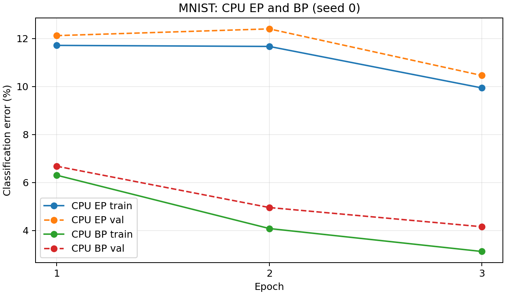

# Equilibrium propagation on MNIST

EPLinear trains a 784-128-10 network using ±1 spins. Kaiwu SA solves free and
nudged phases; PyTorch differentiates their energy difference. Use Python 3.10,
Kaiwu 1.3.1 and PyTorch 2.7.0, with the SDK license initialized locally.

```sh
python example/ep_mnist/train_mnist.py --epochs 3 --device cpu --threads 1 --seed 0 --split-seed 0 --data-dir data --output-dir runs/ep-mnist
```

Use `--device cuda` for CUDA model tensors; SA stays on CPU. The split is
55000 train / 5000 validation / 10000 test. The final test runs after epoch 3.
Beta is 2, initialization scale 2, batch size 20, learning rate 0.05 and SA
iterations per temperature 50. `--validation-only` excludes the test set.
`--evaluate` restores a checkpoint for evaluation, not training resume.

## Reference observations

| Execution | Test accuracy | Total (min) | SA (min) | Non-SA (min) |
| --- | ---: | ---: | ---: | ---: |
| CPU EP | 90.30% | 353.004 | 341.725 | 11.279 |
| CUDA EP + CPU SA | 89.06% | 453.329 | 386.931 | 66.398 |

CPU BP reaches 96.20% with matching split, seed, widths and training schedule,
but uses ReLU/cross entropy and different initialization. These are single-seed
results, not a controlled speedup comparison. Totals include training,
train/validation evaluation and final testing. Non-SA includes transfers and
Python overhead. Full training was not repeated after this cleanup.



[Per-epoch CSV](../../../_static/ep-mnist/training_curves.csv)

Curves show training and validation error, not per-epoch test accuracy. EP's
energy objective is not numerically comparable to BP cross entropy. Compact
summaries and source links are in `example/ep_mnist/reference_results/`.
Regenerate the image and CSV with `python example/ep_mnist/plot_reference_results.py
--output-dir runs/ep-reference-figures` from the repository root.
