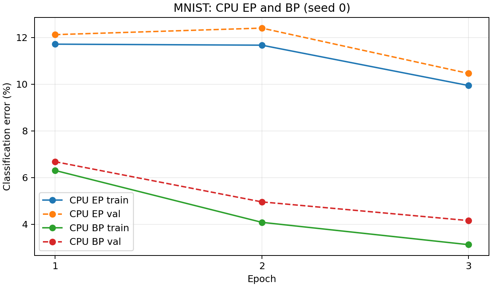

# Equilibrium propagation on MNIST

## Setup and execution

The retained experiments used Python 3.10, Kaiwu 1.3.1, PyTorch 2.7.0 and torchvision 0.22.0. Use these versions to reproduce the recorded environment; the plugin's current compatibility ranges are documented in the [repository README](../../README.md).
Initialize your SDK license locally before real SA execution.

```sh
python -m pip install -e .
python -m pip install -r example/ep_mnist/requirements.txt
python example/ep_mnist/train_mnist.py --device cpu --threads 1 --epochs 3 --seed 0 --split-seed 0 --data-dir data --output-dir runs/ep-cpu
python example/ep_mnist/train_mnist.py --device cuda --threads 1 --epochs 3 --seed 0 --split-seed 0 --data-dir data --output-dir runs/ep-cuda
```

Use `--device cuda:N` to select a GPU and install the matching PyTorch CUDA wheel.
The default device is CPU and the default epoch count is one. Parameters are
initialized on CPU before migration; TF32 is disabled. Set OMP_NUM_THREADS=1
and MKL_NUM_THREADS=1 to reproduce the recorded thread configuration.

MNIST pixels are divided by 255. The split reserves 5000 of the 60000 official
training images for validation, leaving 55000 for training; 10000 test images
are evaluated after the final epoch. `--split-seed` controls the split separately
from `--seed`. For a quick check, add `--limit-train 20 --limit-eval 20`.
Use `--validation-only` for tuning without loading or evaluating the test set.

## Model and outputs

The default EPLinear network is 784-128-10 with discrete ±1 spins. Beta is 2,
first-layer initialization scale 2, SGD learning rate 0.05 and batch size 20.
The SA sampler uses 50 iterations per temperature. Each batch runs free and
nudged phases; PyTorch differentiates their energy difference. Prediction uses
the last layer's fields from the free-phase state. The sampler's reference spin
is decoded and the lowest-energy returned candidate is selected.

`--conv` replaces the first layer with EPConv2d (4 channels, kernel 7, stride 3).

```sh
python example/ep_mnist/train_mnist.py --conv --input-scale 4 --sa-iterations 100 --output-dir runs/ep-conv
python example/ep_mnist/train_mnist.py --device cpu --data-dir data --evaluate runs/ep-cuda/checkpoint.pt --output-dir runs/ep-evaluation
```

Always use a new output directory. Each epoch saves `checkpoint.pt` and
`summary.json` (`summary_conv.json` for convolution). Evaluation restores model
configuration and sampler settings, takes the device from the command line,
and writes `evaluation.json`. Checkpoints support evaluation, not training resume.
No new complete convolutional training result is claimed here.

## Reference results and timing

| Execution | Test accuracy | Total (min) | SA (min) | Non-SA (min) |
| --- | ---: | ---: | ---: | ---: |
| CPU EP | 90.30% | 353.004 | 341.725 | 11.279 |
| CUDA EP + CPU SA | 89.06% | 453.329 | 386.931 | 66.398 |

These are three-epoch single-seed observations. CPU EP final training/validation
accuracies are 90.06% / 89.54%. CPU BP reaches 96.20% test accuracy using the same
split, widths, seed, learning rate, batch size and epochs, but ReLU/cross entropy
and different initialization. EP's energy objective may be negative and must not
be compared numerically with BP cross entropy.



[Per-epoch CSV](../../docs/_static/ep-mnist/training_curves.csv) ·
[Reference summaries, environments and provenance](reference_results/README.md) ·
[Validation](../../tests/README.validation.md)

The curve is classification error (1 - accuracy), not per-epoch test accuracy.
The table sums all training, train/validation evaluation and final test phases.
Each phase records total, SA, non-SA and call counts, with CUDA synchronization
at phase boundaries. SA remains on CPU; non-SA includes transfers and Python
overhead. Full EP uses 110000 SA calls per training epoch, 60000 per evaluation
and 10000 for final testing. Different execution times and entrypoints prevent
a controlled speedup claim. These archived results were not rerun after cleanup.
