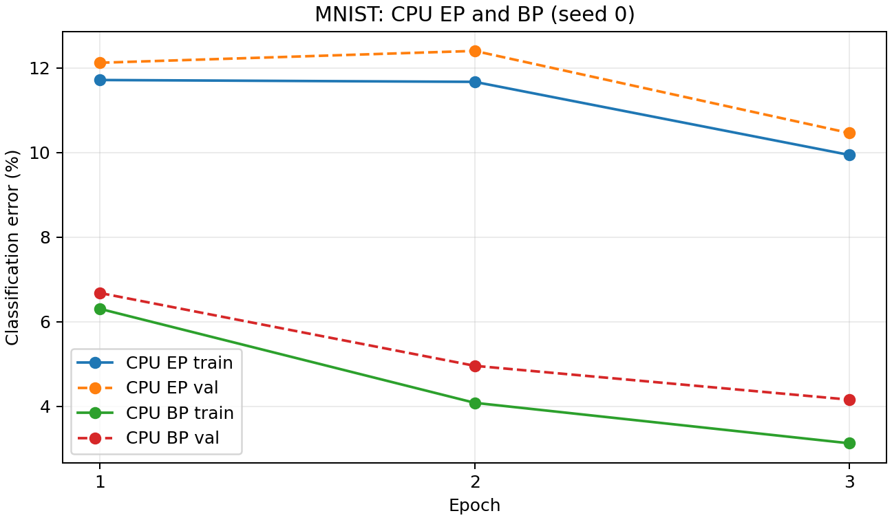

# MNIST 上的均衡传播

## 安装与结果来源

使用 Python 3.10 和已安装的 Kaiwu 1.3.1 SDK，在仓库根目录执行：

```bash
python -m pip install -e .
python -m pip install -r example/ep_mnist/requirements.txt
```

示例依赖增加 torchvision 0.22.0 和 matplotlib 3.10.3，不修改插件运行依赖。
默认训练一轮，复现历史完整配置需显式指定 `--epochs 3`。
`--evaluate` 仅恢复检查点进行评估，不支持断点续训。

下文三轮结果来自 `93a536b` 加本地修改的历史运行，源码哈希见
[provenance.json](closeout/provenance.json)。本次最终整理未重跑完整实验；
新的小规模检查独立记录在[验证说明](../../tests/README.validation.md)中。

本示例支持完整数据集训练和 MNIST 小样本验证。快速验证时使用 `--limit-train 20 --limit-eval 20`，并用 `--output-dir` 指定独立输出目录，完整命令见下文。

在完整的原版 MNIST 上训练均衡传播网络。数据通过 `torchvision.datasets.MNIST` 读取，像素除以 255。每个单元都是 ±1 自旋，自由相和微扰相的 Ising 矩阵都由 Kaiwu 1.3.1 模拟退火求解。

测试集是官方的 10000 张测试图。从 60000 张训练图里随机留出 5000 张作验证集，剩下 55000 张用于训练。`--split-seed`（默认 0）固定数据划分。`--seed`（默认 0）控制初始权重、训练顺序和训练退火。超参数在 2000 张训练图上按验证准确率选择。

示例通过 `TensorDataset` 和 `DataLoader` 提供批次。用 `EPLinear`、`EPConv2d` 组装 `EquilibriumPropagation`，用 `equilibrate(inputs, sampler)` 求自由相，用 `equilibrate(inputs, sampler, targets, beta)` 求微扰相。目标类别编码为 +1，其余为 -1。对 `objective(inputs, free, nudged, beta)` 自动求导并调用优化器更新。预测取自由相状态下输出层局域场最大的类别。

输入钳制项和偏置进入局域场，微扰相在输出局域场加入 `beta * target`。参考自旋把局域场编码进 Ising 矩阵，求解后选择能量最低的候选。两个相位使用相同的退火配置。`--sa-iterations` 控制每个温度的退火迭代次数，自旋是离散翻转，因此没有连续状态更新步长。

## 全连接网络（默认）

784-128-10，第一层初始化放大 2 倍，beta 取 2，SGD 学习率 0.05，批大小 20。退火每个温度迭代 50 次：迭代 10 次时，单点翻转还能让能量继续下降，说明解没有收敛。

```powershell
python example/ep_mnist/train_mnist.py --epochs 3 --output-dir runs/ep-mnist-linear
```

首次运行会把 MNIST 下载到 `example/ep_mnist/data/`；已有数据时用 `--data-dir` 指定所在目录。完整三轮训练的最终结果见下文。

## 三轮训练最终结果

完整数据训练已完成，训练种子与划分种子均为 0：训练 55,000 张、验证 5,000 张、官方测试 10,000 张。最终训练准确率为 **90.06%**，验证准确率为 **89.54%**，测试准确率为 **90.30%**。测试集仅在第三轮结束后评估。这是单种子结果，不是多种子均值。历史一轮测试准确率为 88.72%。

BP 对照使用相同划分、种子、层宽、批大小、学习率和三轮训练，测试准确率为 **96.20%**，相差 5.90 个百分点。BP 使用 ReLU、交叉熵和 PyTorch 默认初始化；EP 使用离散自旋及自身的初始化方式。

EP 平均每轮训练耗时 10,422.09 秒，每轮训练集与验证集评估耗时 5,653.59 秒；BP 分别为 5.16 秒和 2.72 秒。以上是记录环境中的实际墙钟耗时，不代表通用性能基准，最终测试评估耗时另计。



[曲线 PDF](../../docs/_static/ep-mnist/training_curves.pdf) · [逐轮 CSV](../../docs/_static/ep-mnist/training_curves.csv) · [EP 汇总](closeout/ep-full/summary.json) · [BP 汇总](closeout/bp/summary.json)

曲线展示分类错误率（1 − 准确率），不包含逐轮测试准确率。EP 的两相能量差目标可以为负值，与 BP 的交叉熵含义不同，应比较分类错误率而非目标值大小。β 与退火预算对照使用 2,000 张训练图、1,000 张验证图、三轮训练及种子 0/1/2，仅报告验证结果。

配置、代码来源及图表再生成方式见[证据归档](closeout/README.md)。下方卷积结果仍为历史一轮结果，本次未报告新的三轮卷积结果。

## 卷积网络

`--conv` 把第一层换成 `EPConv2d`：4 个通道，卷积核 7，步长 3，输出 4×8×8 = 256 个自旋，之后接 10 个输出自旋。自旋更多，退火每个温度迭代 100 次；第一层初始化放大 4 倍。

```powershell
python example/ep_mnist/train_mnist.py --conv --input-scale 4 --sa-iterations 100 --output-dir runs/ep-mnist-conv
```

以下结果使用种子 0，训练了 1 个 epoch。

验证准确率：0.6966；测试准确率：0.7155。

## 耗时

训练更新对每个样本求解两个相位，每轮共 110000 次。每轮还评估训练集和验证集，共 60000 次自由相求解。最终测试另需 10000 次。本次三轮训练平均每轮更新约 2.90 小时，训练集与验证集评估约 1.57 小时，合计约 4.47 小时，最终测试耗时另计。此前单进程约 31 毫秒/次（更新阶段约一小时）及并行全连接/卷积约 72/174 毫秒/次均属历史测量，不作为本次运行的预计耗时。正式运行前可以先用 `--limit-train 2000 --limit-eval 1000` 测量本机速度。

使用 Python 3.10、Kaiwu 1.3.1、PyTorch 2.7.0 和 torchvision 0.22.0。
如果本地 SDK 要求授权，请在运行前初始化授权。

默认输出位于 `example/ep_mnist/results/linear/` 或 `results/conv/`。每次运行使用新目录。每轮更新 `checkpoint.pt` 以及 `summary.json`（卷积模式为 `summary_conv.json`），记录训练和验证准确率、分类错误率、EP 目标值，以及训练和评估耗时。调参时加 `--validation-only` 跳过测试集。

```powershell
python example/ep_mnist/train_mnist.py --limit-train 20 --limit-eval 20 --output-dir runs/ep-mnist-smoke
python example/ep_mnist/train_mnist.py --evaluate runs/ep-mnist-smoke/checkpoint.pt --output-dir runs/ep-mnist-smoke-eval
```

加载时按检查点配置重建网络，恢复 `state_dict`，沿用保存的数据划分和评估求解设置，写出 `evaluation.json`。若训练时指定了 `--data-dir`，加载时也传入该目录。
